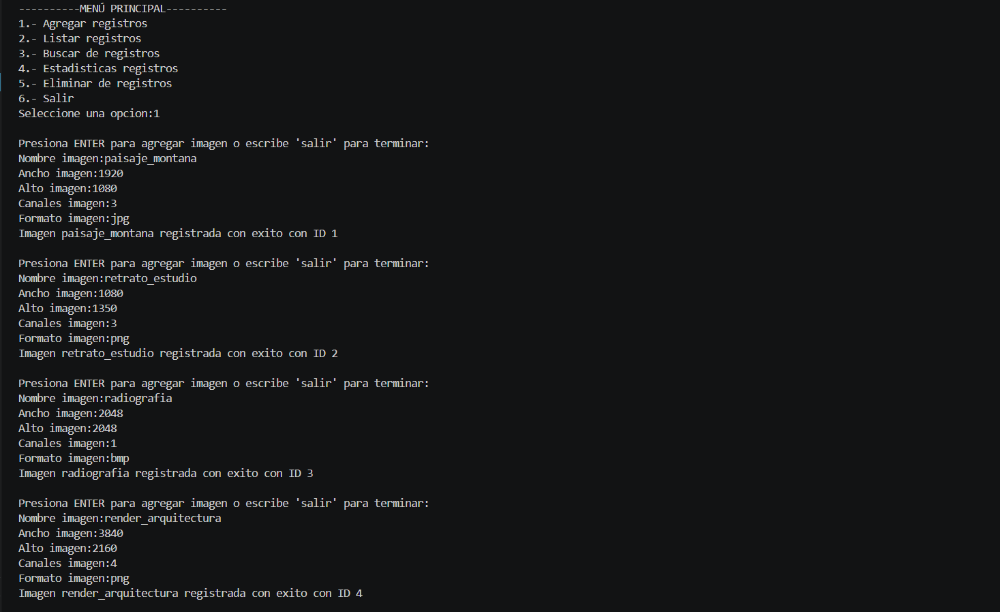
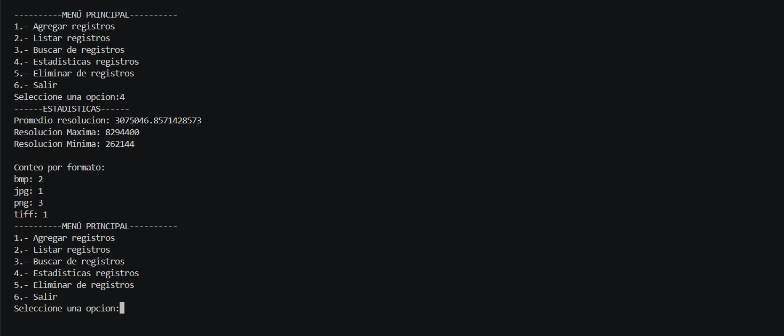
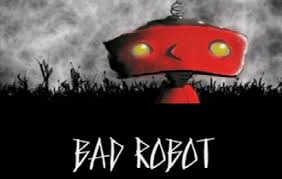
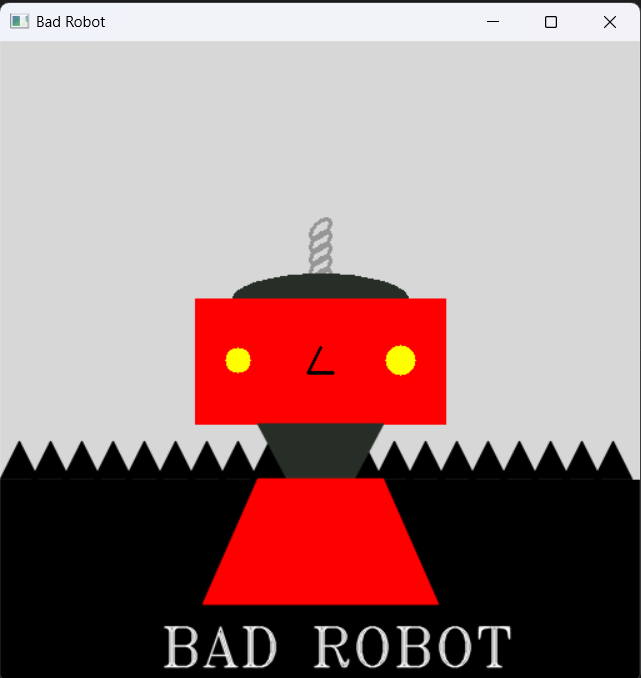

# Inteligencia Artificial — Prácticas


Prácticas de la materia **Inteligencia Artificial** (Ingeniería en Sistemas Computacionales, 8.º semestre, UAT — UAM Mante, 2026). Cada práctica vive en su propia carpeta, con su `README.md`, sus dependencias y capturas de su ejecución.

---

## Prácticas

| # | Práctica | Temas | Tecnologías |
|---|---|---|---|
| 01 | [**Data Mini Lab**](Practica01_DataMiniLab/) — gestor en consola de metadatos de imágenes | Estructuras de datos, modularización, validación de entradas, persistencia en JSON | Python (solo biblioteca estándar) |
| 02 | [**Bad Robot**](Practica02_BadRobot/) — dibujo de un robot con primitivas gráficas | Lienzos con NumPy, rectángulos, círculos, elipses, polígonos, texto; patrones con bucles | Python, OpenCV, NumPy |

### 01 · Data Mini Lab

Sistema CRUD en consola para registros de imágenes (nombre, ancho, alto, canales y formato): agregar con validación, listar, buscar por nombre o formato, eliminar por ID y calcular estadísticas (resolución promedio, máximos, mínimos y conteo por formato). Los datos persisten en `registros.json`.

| Agregar | Estadísticas |
|---|---|
|  |  |

### 02 · Bad Robot

Reproduce la ilustración de un robot usando únicamente primitivas de OpenCV sobre un lienzo de 512×512.

| Referencia | Resultado |
|---|---|
|  |  |

---

## Cómo ejecutar una práctica

**Requisitos:** Python 3.10 o superior.

```bash
git clone https://github.com/EdgarPStder/Inteligencia_artifical.git
cd Inteligencia_artifical/Practica02_BadRobot   # o Practica01_DataMiniLab

python -m venv .venv
# Windows: .venv\Scripts\activate
# Linux/macOS:
source .venv/bin/activate

pip install -r requirements.txt
python bad_robot.py                              # o python data_mini_lab.py
```

## Estructura

```
.
├── Practica01_DataMiniLab/
│   ├── data_mini_lab.py     Menú principal
│   ├── utils.py             Funciones CRUD, estadísticas y persistencia
│   ├── registros.json       Datos de ejemplo
│   └── imgs/                Capturas
└── Practica02_BadRobot/
    ├── bad_robot.py
    └── imgs/                Referencia y resultado
```

---

## Autor

**Edgar Gael Pesina Santander** — Ingeniería en Sistemas Computacionales, Universidad Autónoma de Tamaulipas.
GitHub: [@EdgarPStder](https://github.com/EdgarPStder)

## Licencia

Código bajo licencia [MIT](LICENSE).
